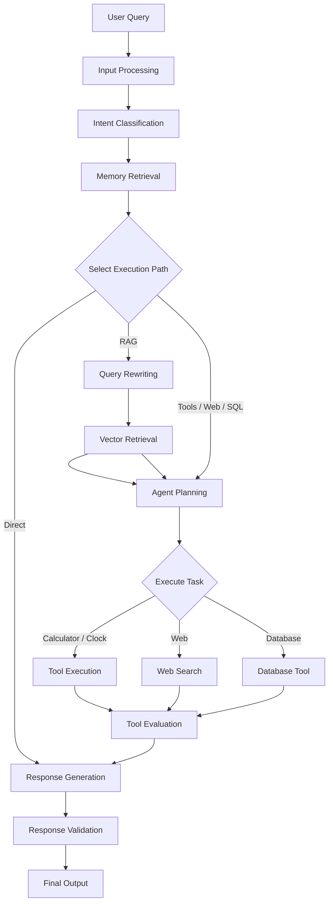

# SAM-AI — Agentic AI Knowledge Assistant

**SAM-AI** is an intelligent, agentic AI-powered knowledge assistant designed to deliver context-aware responses through multi-step reasoning, Retrieval-Augmented Generation (RAG), conversational memory, and dynamic tool execution.

Built using **LangChain, LangGraph, FastAPI, and Streamlit**, SAM-AI combines LLM-powered reasoning with document intelligence, persistent conversation management, and specialized tools to provide a more capable and personalized AI experience.

---

## Key Features

- **Agentic AI Architecture:** Uses LangGraph to orchestrate multi-step workflows, classify user intent, plan tasks, execute tools, and generate responses.
- **Retrieval-Augmented Generation (RAG):** Processes uploaded documents and retrieves relevant information using semantic similarity search.
- **Conversational Memory:** Maintains conversation context and retrieves relevant saved user memories to personalize responses.
- **Intelligent Tool Execution:** Supports specialized tools for mathematical calculations, current date and time retrieval, web search, and restricted database statistics.
- **Document Intelligence:** Supports PDF, DOCX, TXT, and Markdown document uploads, text extraction, chunking, embedding generation, and retrieval.
- **Context-Aware Query Processing:** Rewrites follow-up questions into standalone queries to improve document retrieval.
- **Streaming Responses:** Streams AI-generated responses to the frontend for a more interactive experience.
- **Source Citations:** Provides document references and relevant excerpts to improve response traceability.
- **Secure Authentication:** Implements JWT-based authentication and password hashing.
- **Persistent Conversations:** Uses LangGraph checkpointing to maintain conversation state across requests.
- **LLM Observability:** Integrates LangSmith for tracing and evaluating AI workflows.
- **API Security:** Includes request validation, rate limiting, user-scoped data access, and configurable application limits.

---

## Technology Stack

| Category | Technologies |
|---|---|
| Programming Language | Python |
| LLM Framework | LangChain |
| Agent Orchestration | LangGraph |
| LLM Provider | Hugging Face |
| Backend | FastAPI |
| Frontend | Streamlit |
| Vector Database | ChromaDB |
| Embeddings | Sentence Transformers |
| Relational Database | SQLite / PostgreSQL |
| ORM | SQLAlchemy |
| State Persistence | LangGraph SQLite Checkpointer |
| Cache / Rate Limiting | Redis |
| Observability | LangSmith |
| Authentication | JWT |
| Document Processing | PyPDF, python-docx |
| Testing | Pytest |

---

## System Architecture

SAM-AI follows a modular architecture that separates the user interface, API layer, agent orchestration, knowledge retrieval, and data persistence.

### Request Processing Workflow

1. **User Input:** The user submits a query through the Streamlit interface.
2. **API Layer:** FastAPI validates the request and authenticates the user.
3. **Intent Classification:** The agent identifies whether the query requires direct reasoning, document retrieval, tool execution, web search, or database operations.
4. **Memory Retrieval:** Relevant saved memories and conversation context are retrieved.
5. **Task Planning:** LangGraph determines the appropriate execution path.
6. **Execution:** The system invokes the required tools or performs semantic document retrieval.
7. **Response Generation:** The LLM generates a response using the retrieved context or tool results.
8. **Response Validation:** The generated response is validated before being returned.
9. **Final Output:** The response is streamed to the frontend, with document citations when applicable.

### Agent Workflow



---

## Project Structure

```text
SAM-AI/
│
├── backend/
│   ├── api/
│   │   └── routes.py
│   │
│   ├── graph/
│   │   ├── edges.py
│   │   ├── nodes.py
│   │   ├── state.py
│   │   └── workflow.py
│   │
│   ├── tools/
│   │   ├── calculator.py
│   │   ├── utilities.py
│   │   └── web_search.py
│   │
│   ├── agents.py
│   ├── config.py
│   ├── db.py
│   ├── knowledge.py
│   ├── llm.py
│   ├── main.py
│   ├── models.py
│   ├── schemas.py
│   └── security.py
│
├── frontend/
│   └── app.py
│
├── evals/
│   └── run_langsmith.py
│
├── tests/
│   ├── test_api_isolation.py
│   ├── test_evaluation.py
│   ├── test_graph.py
│   ├── test_knowledge.py
│   ├── test_routing.py
│   ├── test_security.py
│   └── test_tools.py
│
├── .env.example
├── requirements.txt
└── LICENSE
```

---

## Installation and Setup

### 1. Clone the Repository

```bash
git clone https://github.com/Nitin-NSR/SAM-AI.git

cd SAM-AI
```

### 2. Create a Virtual Environment

```bash
python -m venv venv
```

Activate the environment:

**Windows:**
```bash
venv\Scripts\activate
```

**Linux / macOS:**
```bash
source venv/bin/activate
```

### 3. Install Dependencies

```bash
pip install -r requirements.txt
```

### 4. Configure Environment Variables

Create your environment configuration file:

```bash
cp .env.example .env
```

On Windows:

```bash
copy .env.example .env
```

Configure the required environment variables in `.env`:

| Variable | Description |
|---|---|
| `JWT_SECRET` | Secret used for JWT authentication |
| `HF_TOKEN` | Hugging Face access token, if required |
| `HF_CHAT_MODEL` | Hugging Face chat model |
| `HF_EMBEDDING_MODEL` | Sentence Transformer embedding model |
| `DATABASE_URL` | Application database connection |
| `CHECKPOINT_DB_URL` | LangGraph checkpoint database |
| `CHROMA_DIR` | Persistent ChromaDB storage directory |
| `REDIS_URL` | Optional Redis connection |
| `WEB_SEARCH_URL` | Optional external web search endpoint |
| `LANGSMITH_API_KEY` | LangSmith API key |
| `LANGSMITH_TRACING` | Enable or disable LangSmith tracing |

**Important:** Replace default secrets before running the application in a production environment. Never commit your actual `.env` file or API credentials.

### 5. Start the Backend

Run the FastAPI application:

```bash
uvicorn backend.main:app --reload
```

Backend API:

```text
http://127.0.0.1:8000
```

API documentation:

```text
http://127.0.0.1:8000/docs
```

### 6. Start the Frontend

Open another terminal, activate the virtual environment, and run:

```bash
streamlit run frontend/app.py
```

Frontend application:

```text
http://localhost:8501
```

You can now register an account, upload documents, manage saved memories, and interact with SAM-AI.

---

## How RAG Works in SAM-AI

SAM-AI implements a document-based Retrieval-Augmented Generation pipeline.

**Document Ingestion:**

1. Upload a supported document.
2. Extract text using document-processing libraries.
3. Split extracted text into smaller chunks.
4. Generate vector embeddings using Sentence Transformers.
5. Store embeddings and metadata in ChromaDB.

**Query Retrieval:**

1. Receive a user query.
2. Rewrite follow-up questions when necessary.
3. Convert the query into an embedding.
4. Retrieve semantically relevant document chunks.
5. Pass retrieved context to the LLM.
6. Generate an answer grounded in retrieved information.
7. Return the answer with source citations.

---

## Testing

SAM-AI includes automated tests for its core components.

Run the test suite using:

```bash
pytest -v
```

Test coverage includes:

- Agent workflow and graph execution.
- Intent classification and routing.
- Document ingestion and retrieval.
- Tool execution.
- Authentication and security.
- API user isolation.
- Evaluation workflows.

---

## Observability and Evaluation

SAM-AI integrates **LangSmith** to support LLM workflow observability and evaluation.

It enables developers to inspect agent execution, trace workflow steps, analyze model interactions, and evaluate response quality.

Configure the LangSmith environment variables to enable tracing and run the evaluation script:

```bash
python -m evals.run_langsmith
```

---

## Security Considerations

The application incorporates several security mechanisms:

- JWT-based user authentication.
- Password hashing.
- User-scoped document and memory retrieval.
- Parameterized database operations.
- Restricted calculator execution without arbitrary code evaluation.
- Request size and upload size limits.
- Configurable rate limiting with Redis support.
- Production secret validation.
- Input and response validation.

For production deployment, configure HTTPS, secure secrets management, database backups, and appropriate access controls.

---

## Future Enhancements

Potential areas for further development include:

- Advanced multi-agent collaboration.
- More specialized AI tools and integrations.
- Improved long-term semantic memory.
- Hybrid search combining keyword and vector retrieval.
- Advanced reranking for better retrieval accuracy.
- Expanded evaluation datasets and automated quality metrics.
- Docker-based deployment and CI/CD automation.
- Production monitoring and performance optimization.

---

## License

This project is licensed under the **Apache License 2.0**. See the [LICENSE](LICENSE) file for details.

---

## Author

**Nitin**

GitHub: [@Nitin-NSR](https://github.com/Nitin-NSR)

Project Repository: [SAM-AI](https://github.com/Nitin-NSR/SAM-AI)

---

*SAM-AI — Moving beyond traditional chatbots towards intelligent, context-aware, and tool-using AI systems.*
